## Assignment: High-Availability Web Service with Load Balancing
## Course Module: Cloud & DevOps – Load Balancing
## Type: Individual, hands-on
Total Marks: 100

## Submitted By 
## Arif Muhammad

## 1. Architechrue Diagram 
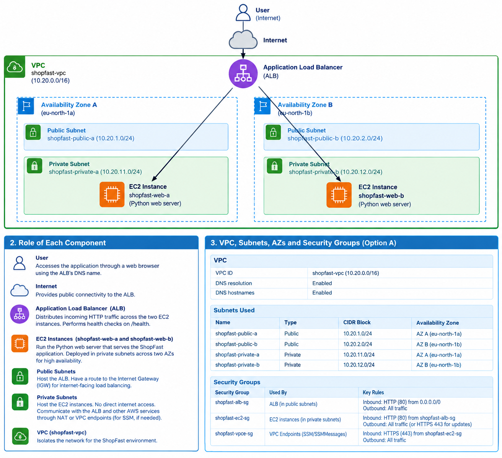

## 2. Role of Each Component

### 2.1 User
The user accesses the ShopFast web application through a web browser using the public DNS name of the Application Load Balancer (ALB). The user does not connect directly to the EC2 instances.

### 2.2 Application Load Balancer (ALB)
The internet-facing Application Load Balancer receives HTTP requests on port `80` and distributes them between the two EC2 instances in different Availability Zones.

Its responsibilities include:
- Distributing incoming traffic across healthy instances.
- Performing health checks using the `/health` endpoint.
- Forwarding requests only to healthy registered targets.
- Improving availability by routing traffic to the remaining healthy instance if one instance becomes unhealthy.

### 2.3 EC2 Web Server Instances
Two EC2 instances, `shopfast-web-a` and `shopfast-web-b`, run the Python web application.

Each instance:
- Runs the Python web server on port `80`.
- Responds to incoming HTTP requests forwarded by the ALB.
- Provides a `/health` endpoint that returns HTTP `200 OK` when healthy.
- Runs inside a private subnet without a public IP address.

The instances are placed in separate Availability Zones to reduce the impact of an individual instance or Availability Zone failure.

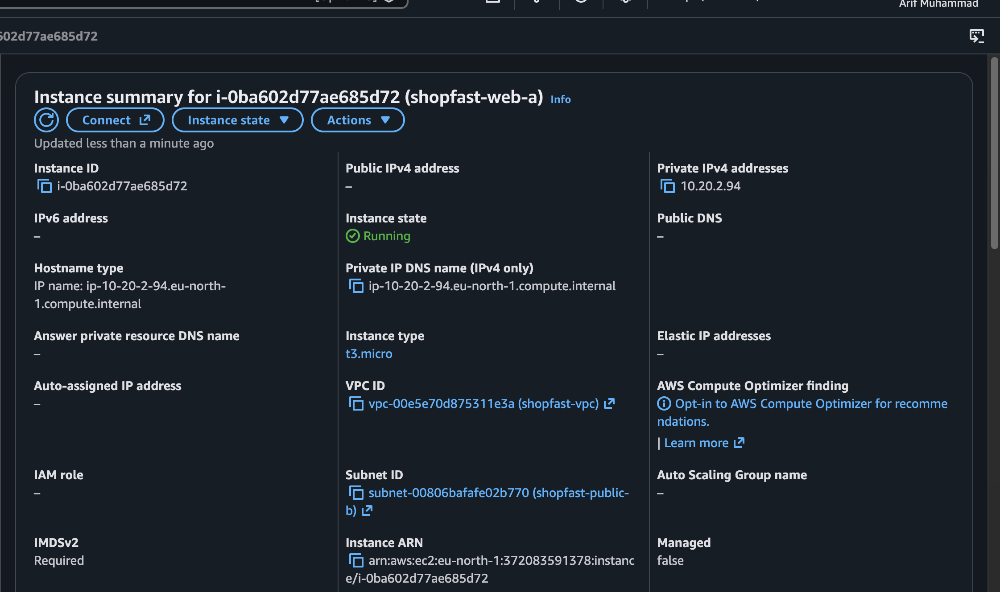

### 2.4 Availability Zones (AZs)
The application uses two Availability Zones in the AWS Europe (Stockholm) Region, `eu-north-1`.

Each AZ contains a private subnet and an EC2 web server instance. Deploying across two AZs improves fault tolerance and helps keep the application available if one AZ experiences a disruption.

### 2.5 Virtual Private Cloud (VPC)
The VPC, `shopfast-vpc`, provides an isolated network environment for the application. It contains the public and private subnets, route tables, security groups, Internet Gateway, and VPC interface endpoints.
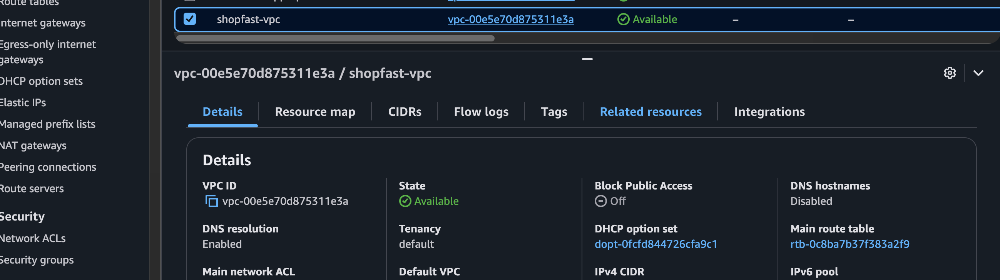

### 2.6 Public Subnets
The public subnets host the internet-facing ALB. Their route table contains a default route (`0.0.0.0/0`) to the Internet Gateway, allowing internet traffic to reach the load balancer.

The EC2 web servers are not placed in these public subnets.

### 2.7 Private Subnets
The private subnets host the EC2 web server instances. They do not have a direct route to the Internet Gateway, and the instances do not have public IP addresses.

Inbound HTTP traffic is permitted only from the ALB security group. AWS Systems Manager access is provided through VPC interface endpoints, avoiding the need to expose SSH publicly.

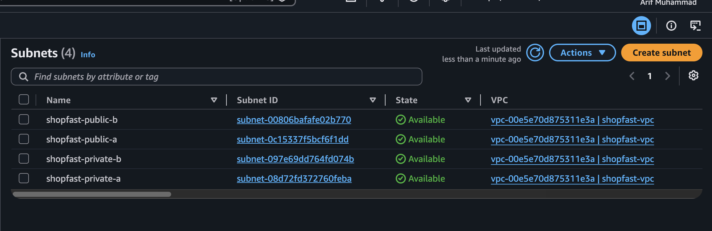
### 2.8 Internet Gateway (IGW)
The Internet Gateway connects the VPC to the internet. It allows the public ALB to receive requests from users over the internet, in conjunction with the public subnet routes and ALB security group.

### 2.9 Security Groups
Security groups act as virtual firewalls that control inbound and outbound traffic.

- **`shopfast-alb-sg`:** Allows inbound HTTP traffic on port `80` from `0.0.0.0/0`.
- **`shopfast-ec2-sg`:** Allows inbound HTTP traffic on port `80` only from `shopfast-alb-sg`.
- **`shopfast-vpce-sg`:** Allows inbound HTTPS traffic on port `443` from `shopfast-ec2-sg` for Systems Manager interface endpoints.

This setup limits direct access to the web servers and follows the principle of least privilege.

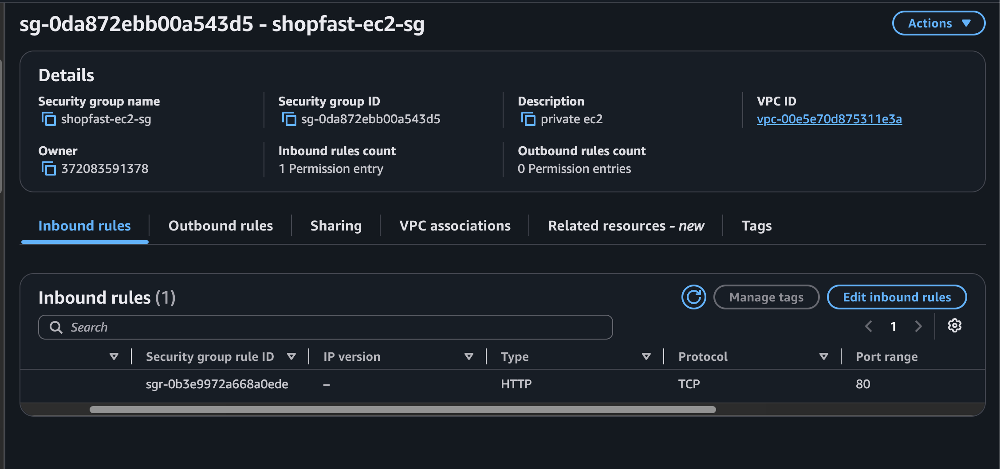

### 2.10 Systems Manager (SSM) VPC Endpoints
The VPC includes the interface endpoints `com.amazonaws.eu-north-1.ssm` and `com.amazonaws.eu-north-1.ssmmessages`.

These endpoints allow the private EC2 instances to communicate with AWS Systems Manager without requiring public IP addresses or inbound SSH access. The instances also require an appropriate IAM role and a running SSM Agent.
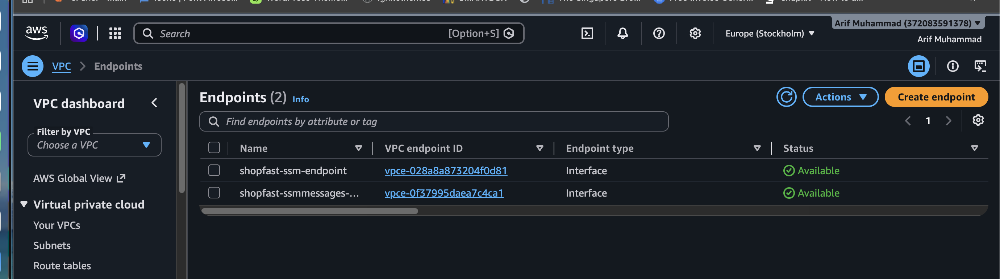
---

## 3. Option A: VPC, Subnets, Availability Zones, and Security Groups

### 3.1 VPC Configuration

| Setting | Value |
|---|---|
| VPC Name | `shopfast-vpc` |
| VPC ID | `vpc-00e5e70d875311e3a` |
| IPv4 CIDR | `10.20.0.0/16` |
| AWS Region | Europe (Stockholm) — `eu-north-1` |
| Internet Gateway | `shopfast-igw` |
| Public Route Table | `shopfast-public-rt` |

The VPC contains two public subnets for the load balancer and two private subnets for the application servers.

### 3.2 Subnet Configuration

| Subnet Name | Type | CIDR Block | Availability Zone | Purpose |
|---|---|---|---|---|
| `shopfast-public-a` | Public | `10.20.1.0/24` | AZ A — 
| `shopfast-public-b` | Public | `10.20.2.0/24` | AZ B — 
| `shopfast-private-a` | Private | `10.20.11.0/24` | AZ A — 
| `shopfast-private-b` | Private | `10.20.12.0/24` | AZ B — 

**Routing configuration:**
- The public route table has a default route (`0.0.0.0/0`) pointing to `shopfast-igw`.
- The public subnets are associated with `shopfast-public-rt`.
- The private subnets do not use a direct Internet Gateway route.
- Systems Manager connectivity is provided through VPC interface endpoints.

### 3.3 EC2 Instance Configuration

| Setting | Instance A | Instance B |
|---|---|---|
| Instance Name | `shopfast-web-a` | `shopfast-web-b` |
| Subnet | `shopfast-private-a` | `shopfast-private-b` |
| Availability Zone | AZ A | AZ B |
| Public IP | None | None |
| Application | Python web server | Python web server |
| Listening Port | `80` | `80` |
| Health Check Path | `/health` | `/health` |
| Security Group | `shopfast-ec2-sg` | `shopfast-ec2-sg` |

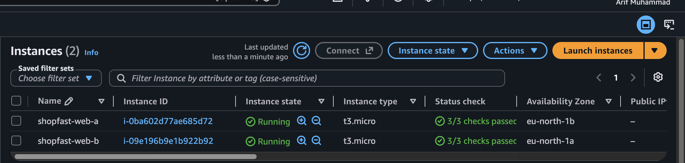

### 3.4 Security Group Configuration

| Security Group | Attached To | Inbound Rules | Purpose |
|---|---|---|---|
| `shopfast-alb-sg` | Application Load Balancer | HTTP `80` from `0.0.0.0/0` | Allows users to access the ALB |
| `shopfast-ec2-sg` | Both EC2 instances | HTTP `80` from `shopfast-alb-sg` only | Allows application traffic only from the ALB |
| `shopfast-vpce-sg` | Systems Manager VPC interface endpoints | HTTPS `443` from `shopfast-ec2-sg` | Allows EC2 instances to connect to Systems Manager |

The default outbound rules permit the required outbound connections. In particular, EC2 instances must be able to establish HTTPS connections to the Systems Manager endpoints.

### 3.5 Load Balancer and Target Group

| Setting | Value |
|---|---|
| Load Balancer | `shopfast-alb` |
| Scheme | Internet-facing |
| IP Address Type | IPv4 |
| Listener | HTTP port `80` |
| Target Group | `shopfast-tg` |
| Target Type | Instances |
| Target Port | `80` |
| Health Check Protocol | HTTP |
| Health Check Path | `/health` |
| Expected Success Code | `200` |

Both EC2 instances are registered in `shopfast-tg`. The ALB uses health checks to determine whether each instance can receive application traffic.

### 3.6 High Availability and Security Summary

This design improves availability by deploying the application servers across two Availability Zones and using an Application Load Balancer to distribute requests. If one target becomes unhealthy, the ALB can route requests to the remaining healthy target.

Security is improved by keeping the EC2 instances in private subnets, removing public IP addresses, restricting application traffic to the ALB security group, and using Systems Manager for administrative access without exposing SSH to the internet.

## 4 Test Result Screenshots

### 4.1  10 Requests to load Balancer
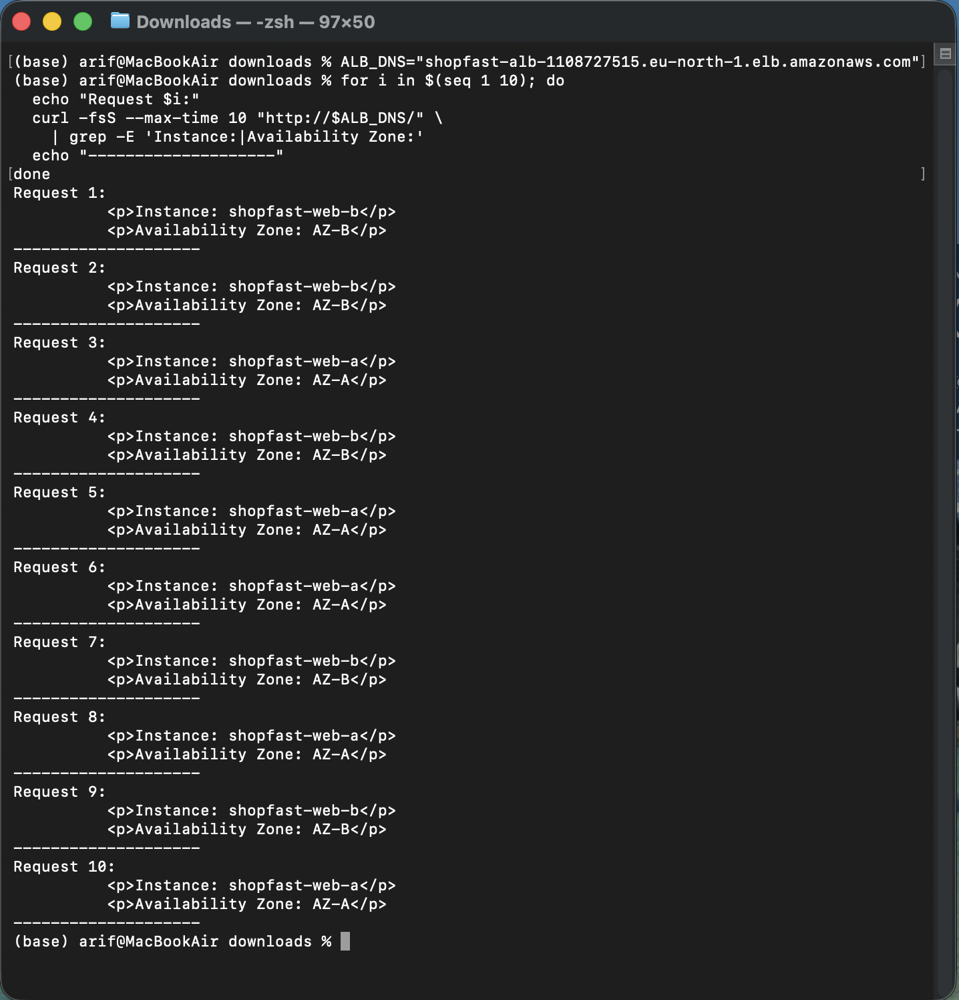

### 4.2  A Instance from browser
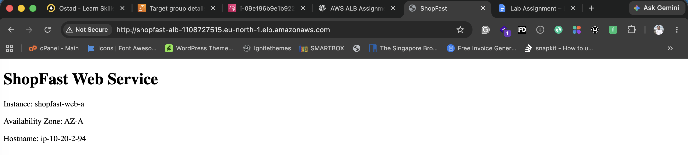

### 4.3  B Instance from browser

### 4.4  Two instance Healthy
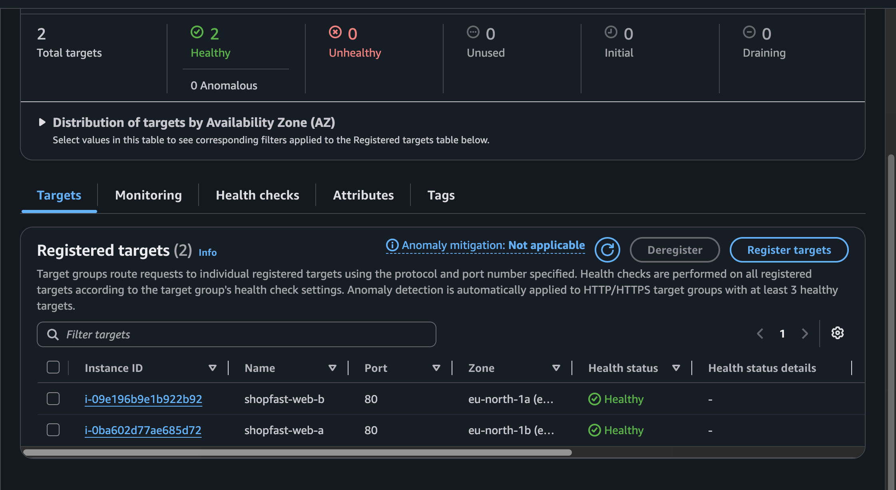

### 4.4  One instance Stopped
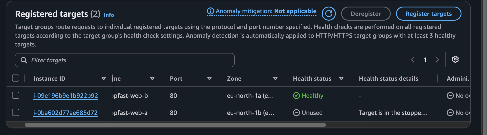

### 4.5  Target-group-metrics
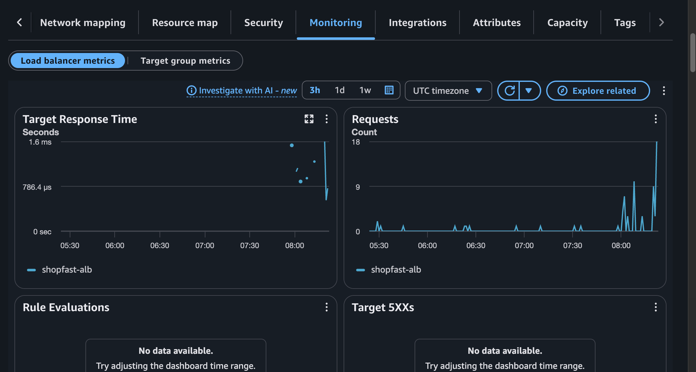

## Problem 6 – Reflection

### 1. AWS Application Load Balancer (ALB) vs. NGINX

AWS Application Load Balancer (ALB) and NGINX can both distribute incoming traffic across multiple web servers, but they differ in management and flexibility.

**Advantages of AWS ALB:**
- It is a managed AWS service, so AWS handles its underlying infrastructure and scaling.
- It supports health checks and automatically routes traffic to healthy targets.
- It integrates with AWS services such as EC2, Auto Scaling, and CloudWatch.
- It can distribute traffic across multiple Availability Zones.

**Limitations of AWS ALB:**
- It incurs additional costs.
- Configuration is less flexible than a self-managed NGINX server for some advanced routing and custom proxy requirements.
- It depends on AWS services and their configuration.

**Advantages of NGINX:**
- It provides flexible reverse proxying, load balancing, caching, and request-routing options.
- It can be installed on an EC2 instance and gives administrators more control.

**Limitations of NGINX:**
- Administrators must manage updates, configuration, monitoring, and scaling.
- A single NGINX instance can become a single point of failure.

For this assignment, I chose AWS ALB because it provides managed load balancing, health checks, and multi-AZ support with less operational overhead.

### 2. What If the Load Balancer Failed?

If a single load balancer became unavailable, users might be unable to access the application even if both EC2 web servers were running correctly. The load balancer is therefore a critical component of the architecture.

In a real production environment, AWS Application Load Balancer is designed to operate across multiple Availability Zones. AWS manages the underlying load-balancing infrastructure and distributes traffic through load balancer nodes in the enabled Availability Zones. This reduces the risk of a single infrastructure component causing a complete service outage.

For high availability, the ALB should be configured with subnets in at least two Availability Zones, and the target instances should also be distributed across separate Availability Zones. Health checks help the ALB stop routing requests to unhealthy application servers.

However, multi-AZ deployment does not eliminate every possible failure. Incorrect configuration, application problems, DNS issues, or a regional AWS outage can still affect availability. Production systems may use infrastructure as code, monitoring and alarms, automated recovery, and disaster-recovery plans. For regional resilience, an architecture may also use a second AWS Region and a service such as Amazon Route 53 for failover.

### 3. A Problem I Faced and How I Solved It

One major problem I faced during this assignment was that the Python web server did not start successfully through the EC2 instance User Data script. As a result, the Application Load Balancer health checks failed, and the registered EC2 targets showed an unhealthy status. The application was not listening on port 80, so the `/health` endpoint could not return HTTP 200.

To troubleshoot the problem, I used AWS Systems Manager (SSM) Session Manager to connect to the private EC2 instances without requiring a public IP address or SSH access. I checked the systemd service status, reviewed service logs with `journalctl`, and tested the local health endpoint using `curl`.

I discovered that the `shopfast-web.service` systemd service was missing or inactive. I then created the Python application file at `/opt/shopfast/server.py`, configured the systemd service, and attempted to enable and start it using `systemctl`.

This experience taught me that User Data scripts can fail and that checking service logs and application health endpoints is essential when troubleshooting cloud deployments. SSM was particularly useful because it allowed me to administer private instances securely.
